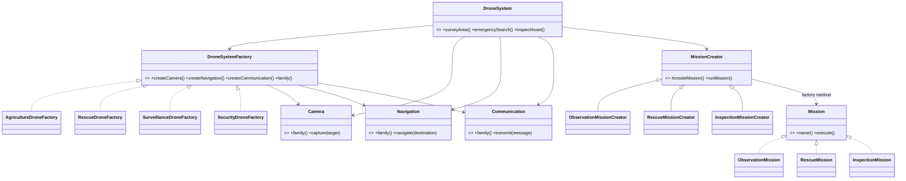

# UML Class Diagram

**Factory Method part:** `MissionCreator#createMission()` is overridden by three concrete creators. The base creator owns the meaningful `runMission()` business workflow.

**Abstract Factory part:** `DroneSystemFactory` creates a compatible camera, navigation module and communication module for one drone family.
